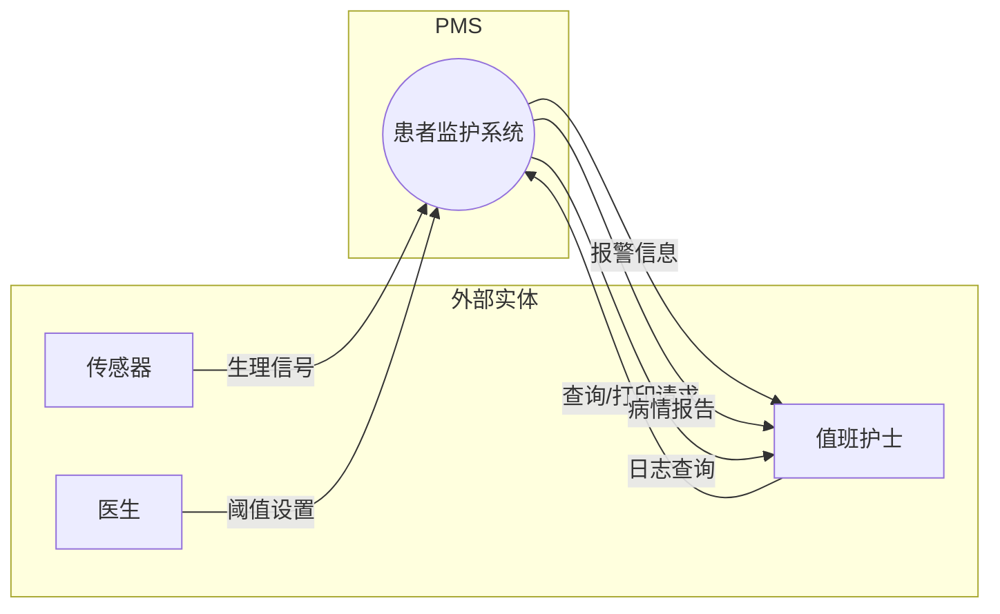
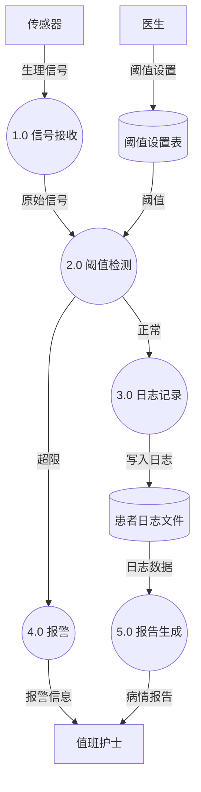
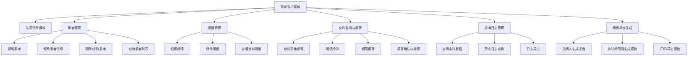

# 软件需求规格说明书

## 一、引言

### 1.1 编写目的
本文档对患者监护系统的功能需求、性能需求、数据需求进行详细描述，作为后续设计、编码和测试的依据。

### 1.2 项目概述

| 项目 | 内容 |
|------|------|
| 项目名称 | 患者监护系统（Patient Monitoring System, PMS） |
| 项目背景 | 某医院拟开发计算机辅助监护系统，替代/辅助人工监护 |
| 目标用户 | 值班护士、主治医生 |
| 核心功能 | 生理信号接收、定时记录、超限报警、病情报告 |

### 1.3 术语定义

| 术语 | 含义 |
|------|------|
| 生理信号 | 脉搏、体温、收缩压/舒张压、心率、心电图等反映生命体征的数值 |
| 安全阈值 | 医生为每位病人设定的生理信号正常范围，超出则触发报警 |
| 患者日志 | 系统定时记录的病人生理信号历史数据 |
| PMS | Patient Monitoring System，本系统缩写 |

---

## 二、数据流图（DFD）

### 2.1 顶层数据流图（0 层）

### 2.2 第 1 层数据流图（分解 P0）

### 2.3 数据字典

| 编号 | 名称 | 类型 | 组成 | 说明 |
|------|------|------|------|------|
| D1 | 患者日志 | 数据存储 | 日志号 + 病人ID + 时间戳 + 脉搏 + 体温 + 收缩压 + 舒张压 + 心率 + ECG摘要 | 定时产生，永久保存 |
| D2 | 阈值设置表 | 数据存储 | 病人ID + 指标类型 + 下限值 + 上限值 + 设置人 + 设置时间 | 按病人/指标维度存储 |
| F1 | 生理信号 | 数据流 | 病人ID + 信号类型 + 数值 + 采集时间 | 传感器→系统 |
| F2 | 阈值设置 | 数据流 | 病人ID + 指标 + 新阈值 | 医生→系统 |
| F3 | 报警信息 | 数据流 | 报警ID + 病人姓名 + 指标 + 当前值 + 阈值 + 时间 | 系统→护士 |
| F4 | 病情报告 | 数据流 | 病人基本信息 + 时间范围 + 指标趋势 + 异常记录 | 系统→护士/医生 |

---

## 三、功能需求

### 3.1 功能分解图

### 3.2 功能详细描述

#### F1 生理信号接收
| 项目 | 说明 |
|------|------|
| 输入 | 病人ID、信号类型（脉搏/体温/收缩压/舒张压/心率）、数值、时间戳 |
| 处理 | 接收并验证信号合法性（数值范围校验），传递给阈值检测模块 |
| 输出 | 合法信号 → F4；非法信号 → 丢弃并记录 |

#### F2 患者管理
| 功能 | 输入 | 处理 | 输出 |
|------|------|------|------|
| F2-1 新增患者 | 病人ID、姓名、性别、年龄、病房号、病床号、主治医生、诊断 | 写入患者信息表 | 成功/失败提示 |
| F2-2 修改患者 | 病人ID + 待修改字段 | 更新患者信息表 | 成功/失败提示 |
| F2-3 出院/删除 | 病人ID | 标记为已出院，保留历史数据 | 成功/失败提示 |
| F2-4 查询列表 | 查询条件（病房/姓名/状态） | 检索患者表 | 匹配的患者列表 |

#### F3 阈值管理
| 功能 | 输入 | 处理 | 输出 |
|------|------|------|------|
| F3-1 设置阈值 | 病人ID + 指标类型 + 上下限 + 设置人 | 写入阈值设置表 | 成功/失败提示 |
| F3-2 修改阈值 | 病人ID + 指标类型 + 新上下限 | 更新阈值设置表 | 成功/失败提示 |
| F3-3 查看阈值 | 病人ID | 读取该病人所有阈值 | 阈值列表 |

#### F4 实时监测与报警（核心功能）
| 功能 | 说明 |
|------|------|
| F4-1 定时采集 | 系统每隔 30 秒自动为每位在院病人生成模拟生理信号 |
| F4-2 阈值检测 | 将当前值与 D2 表中的安全阈值对比 |
| F4-3 超限报警 | 检测到超限 → 在主界面弹窗 + 声音提示 + 写入报警记录 |
| F4-4 报警处理 | 护士可在界面上确认报警，填写处理措施 |

#### F5 患者日志管理
| 功能 | 说明 |
|------|------|
| F5-1 实时数据 | 主界面以表格形式展示所有在院病人最新生命体征 |
| F5-2 历史查询 | 按病人 + 时间范围检索历史日志，支持分页显示 |
| F5-3 日志导出 | 可将查询结果导出为 CSV 文件 |

#### F6 病情报告生成
| 功能 | 说明 |
|------|------|
| F6-1 单人报告 | 选定病人 → 自动汇总时间范围内日志 → 生成文本/HTML 报告 |
| F6-2 时间段报告 | 选定时间范围 → 汇总所有在院病人数据 |
| F6-3 打印/导出 | 报告可打印或导出为文件 |

---

## 四、性能需求

| 指标 | 要求 |
|------|------|
| 响应时间 | 常规操作（查询、设置）< 2 秒；报警响应 < 1 秒 |
| 并发支持 | 支持至少 100 位病人同时监护 |
| 定时精度 | 采集间隔误差 < 5 秒 |
| 数据容量 | 日志数据保存 ≥ 1 年（约 100 病人 × 2880 条/天 × 365 天 ≈ 1 亿条） |
| 系统可用性 | 7×24 小时运行，支持异常恢复 |

## 五、安全需求

| 项目 | 说明 |
|------|------|
| 用户权限 | 护士可查看数据、确认报警；医生可设置阈值、修改患者信息 |
| 数据完整性 | 重要操作（修改阈值、患者出院）需记录操作日志 |
| 报警可靠性 | 同一超限状态仅报警一次，持续监控但不重复弹窗 |

## 六、非功能需求

| 项目 | 说明 |
|------|------|
| 可移植性 | Windows / Linux / macOS 均可运行 |
| 易用性 | 界面直观，关键操作不超过 3 步 |
| 可维护性 | 模块化设计，耦合度低，便于扩展新的生理信号类型 |
