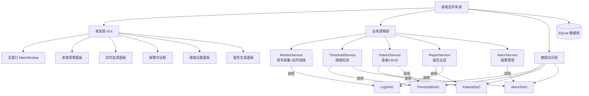
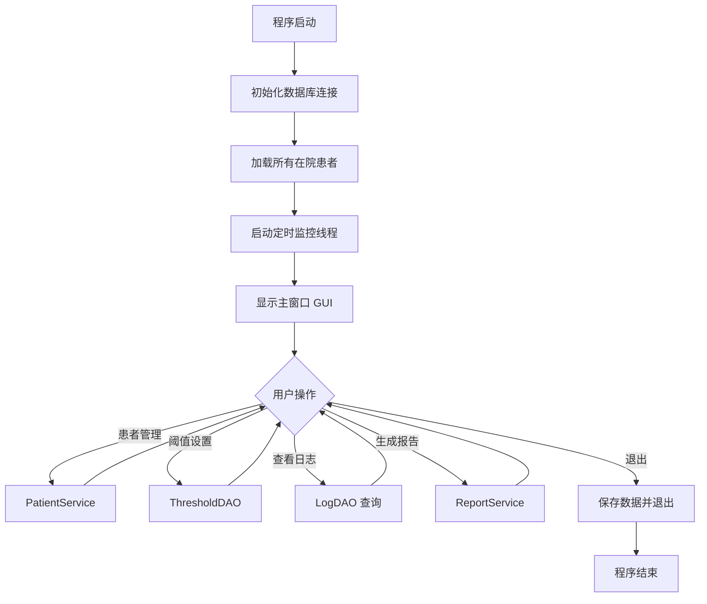

# 总体设计说明书

## 一、引言

本文档描述患者监护系统的总体架构、模块划分、模块间关系及数据流转，为详细设计和编码提供蓝图。

## 二、系统架构

### 2.1 架构风格

采用 **分层架构 + 模块化设计**：

```
┌─────────────────────────────────────────┐
│           表现层 (tkinter GUI)            │
│  MainWindow / PatientPanel / AlarmDialog  │
├─────────────────────────────────────────┤
│           业务逻辑层 (Services)           │
│  MonitorService / ThresholdService /      │
│  ReportService / PatientService           │
├─────────────────────────────────────────┤
│           数据访问层 (Models)              │
│  PatientDAO / LogDAO / ThresholdDAO /     │
│  AlarmDAO                                 │
├─────────────────────────────────────────┤
│           持久化层 (SQLite)               │
│           patient_monitor.db              │
└─────────────────────────────────────────┘
```

### 2.2 设计原则

| 原则 | 说明 |
|------|------|
| 单一职责 | 每个类/模块只负责一件事 |
| 依赖倒置 | 高层模块不依赖具体数据库实现，通过 DAO 接口解耦 |
| 开闭原则 | 新增生理信号类型时不修改现有代码 |
| 分层解耦 | 表现层、业务层、数据层之间通过清晰接口交互 |

## 三、软件结构图



## 四、模块职责说明

### 4.1 业务逻辑层模块

| 模块 | 职责 | 输入 | 输出 |
|------|------|------|------|
| **MonitorService** | 定时为每位在院病人生理信号（模拟），传递给 ThresholdService | 患者列表 | 触发阈值检测 |
| **ThresholdService** | 读取阈值表，将当前值与阈值对比，判断是否超限 | 病人ID + 当前值 | 检测结果（正常/超限） |
| **AlarmService** | 管理报警记录，触发报警通知，处理报警确认 | 超限事件 | 报警记录 + GUI 通知 |
| **PatientService** | 患者信息的增删改查，出入院管理 | 患者操作请求 | 操作结果 |
| **ReportService** | 汇总患者日志数据，生成病情报告文本/HTML | 病人 + 时间范围 | 报告文件 |

### 4.2 数据访问层模块

| 模块 | 职责 |
|------|------|
| **PatientDAO** | 患者信息表的增删改查 |
| **LogDAO** | 生理信号日志表的插入、批量查询 |
| **ThresholdDAO** | 阈值设置表的增删改查 |
| **AlarmDAO** | 报警记录表的插入、状态更新、查询 |

## 五、模块间调用关系

```
MonitorService (定时触发)
      │
      ▼
ThresholdService ──超限──▶ AlarmService
      │                        │
  正常则                     写入 AlarmDAO
  写入 LogDAO                  │
                              ▼
                         通知 GUI 层弹窗
```

## 六、主程序流程


