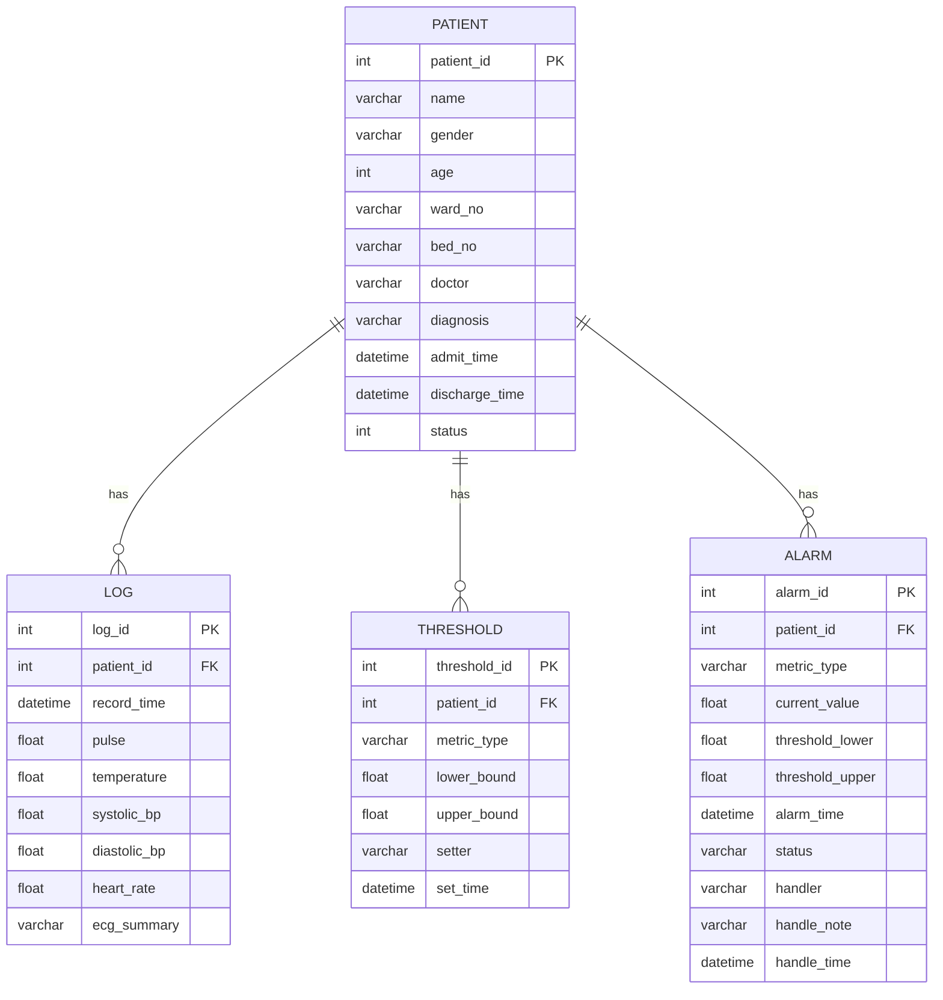

# 数据库设计说明书

## 一、概述

本系统采用 **SQLite 3** 作为嵌入式数据库，所有数据存储在单一文件 `patient_monitor.db` 中，无需额外数据库服务。

## 二、ER 图



## 三、数据表详细设计

### 3.1 patient（患者信息表）

| 字段 | 类型 | 约束 | 说明 |
|------|------|------|------|
| patient_id | INTEGER | PRIMARY KEY AUTOINCREMENT | 患者编号，主键 |
| name | VARCHAR(50) | NOT NULL | 姓名 |
| gender | VARCHAR(10) | NOT NULL | 性别（男/女） |
| age | INTEGER | | 年龄 |
| ward_no | VARCHAR(20) | | 病房号（如 301） |
| bed_no | VARCHAR(10) | | 病床号（如 A1） |
| doctor | VARCHAR(50) | | 主治医生 |
| diagnosis | TEXT | | 诊断 |
| admit_time | DATETIME | NOT NULL DEFAULT CURRENT_TIMESTAMP | 入院时间 |
| discharge_time | DATETIME | | 出院时间（NULL 表示在院） |
| status | INTEGER | NOT NULL DEFAULT 1 | 状态：1=在院，0=已出院 |

**索引**：`idx_patient_ward(ward_no)`, `idx_patient_status(status)`

---

### 3.2 threshold（阈值设置表）

| 字段 | 类型 | 约束 | 说明 |
|------|------|------|------|
| threshold_id | INTEGER | PRIMARY KEY AUTOINCREMENT | 阈值编号 |
| patient_id | INTEGER | NOT NULL, FOREIGN KEY | 患者编号 |
| metric_type | VARCHAR(30) | NOT NULL | 指标类型：pulse/temperature/systolic_bp/diastolic_bp/heart_rate |
| lower_bound | FLOAT | NOT NULL | 下限值 |
| upper_bound | FLOAT | NOT NULL | 上限值 |
| setter | VARCHAR(50) | | 设置人 |
| set_time | DATETIME | NOT NULL DEFAULT CURRENT_TIMESTAMP | 设置时间 |

**唯一约束**：`UNIQUE(patient_id, metric_type)` —— 同一病人同一指标只有一条生效阈值

**索引**：`idx_threshold_patient(patient_id)`

---

### 3.3 log（生理信号日志表）

| 字段 | 类型 | 约束 | 说明 |
|------|------|------|------|
| log_id | INTEGER | PRIMARY KEY AUTOINCREMENT | 日志编号 |
| patient_id | INTEGER | NOT NULL, FOREIGN KEY | 患者编号 |
| record_time | DATETIME | NOT NULL DEFAULT CURRENT_TIMESTAMP | 记录时间 |
| pulse | FLOAT | | 脉搏（次/分） |
| temperature | FLOAT | | 体温（℃） |
| systolic_bp | FLOAT | | 收缩压（mmHg） |
| diastolic_bp | FLOAT | | 舒张压（mmHg） |
| heart_rate | FLOAT | | 心率（次/分） |
| ecg_summary | VARCHAR(50) | | ECG 摘要（模拟） |

**索引**：`idx_log_patient_time(patient_id, record_time DESC)`

---

### 3.4 alarm（报警记录表）

| 字段 | 类型 | 约束 | 说明 |
|------|------|------|------|
| alarm_id | INTEGER | PRIMARY KEY AUTOINCREMENT | 报警编号 |
| patient_id | INTEGER | NOT NULL, FOREIGN KEY | 患者编号 |
| metric_type | VARCHAR(30) | NOT NULL | 超限指标类型 |
| current_value | FLOAT | NOT NULL | 超限时刻的实际值 |
| threshold_lower | FLOAT | | 下限 |
| threshold_upper | FLOAT | | 上限 |
| alarm_time | DATETIME | NOT NULL DEFAULT CURRENT_TIMESTAMP | 报警时间 |
| status | VARCHAR(20) | NOT NULL DEFAULT 'pending' | 状态：pending=未处理, handled=已处理 |
| handler | VARCHAR(50) | | 处理人 |
| handle_note | TEXT | | 处理备注 |
| handle_time | DATETIME | | 处理时间 |

**索引**：`idx_alarm_patient(patient_id)`, `idx_alarm_status(status)`

---

## 四、指标类型与默认阈值参考

| 指标类型 | 中文名 | 单位 | 正常范围参考 | 说明 |
|----------|--------|------|-------------|------|
| pulse | 脉搏 | 次/分 | 60 ~ 100 | 与心率基本一致 |
| temperature | 体温 | ℃ | 36.0 ~ 37.3 | 腋下温度 |
| systolic_bp | 收缩压 | mmHg | 90 ~ 140 | 高压 |
| diastolic_bp | 舒张压 | mmHg | 60 ~ 90 | 低压 |
| heart_rate | 心率 | 次/分 | 60 ~ 100 | ECG 推导 |

> 注意：实际阈值由医生根据患者具体病情设定，以上仅为普通成年人参考值。

## 五、表间关系

```
patient (1) ──→ (N) threshold   一个病人有多个指标阈值
patient (1) ──→ (N) log         一个病人有多条生理信号日志
patient (1) ──→ (N) alarm       一个病人可产生多次报警
```

## 六、数据初始化脚本

系统首次启动时自动执行初始化，创建所有表和示例数据（3~5 名模拟患者），便于演示和测试。
