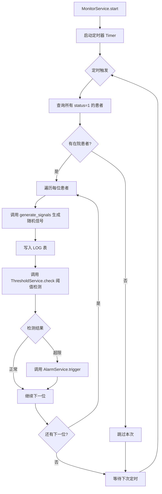
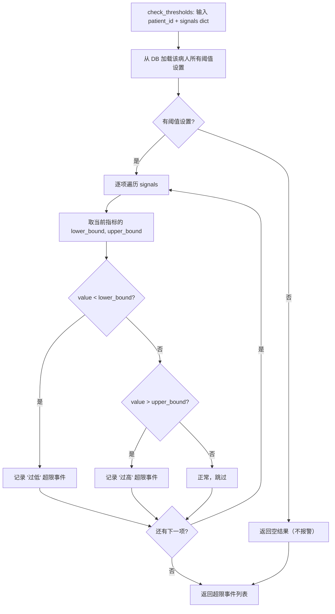
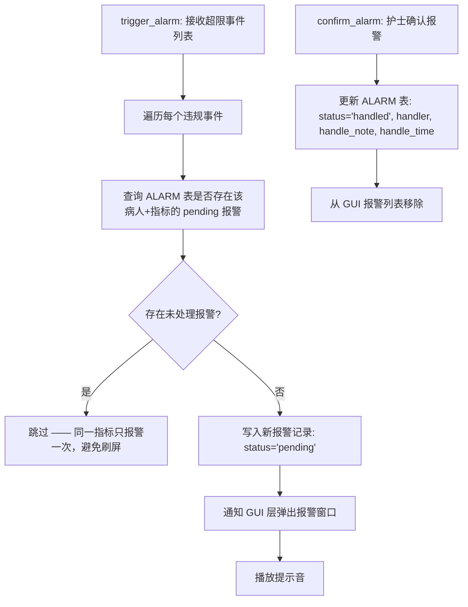

# 详细设计说明书

## 一、引言

本文档对各核心模块进行详细设计，包括主要算法流程图、关键数据结构和接口定义。

## 二、模块详细设计

### 2.1 MonitorService — 定时信号采集模块

**功能**：每隔固定时间（默认 30 秒）为每位在院病人模拟生成生理信号。

**流程图**：



**模拟信号生成算法**（generate_signals）：

```python
def generate_signals(patient_id):
    signals = {}
    # 基于病人 ID 生成稳定的随机种子，让同一病人信号不会完全乱跳
    seed = patient_id * 17 + int(time.time())
    rng = random.Random(seed)
    
    signals['pulse']        = round(rng.uniform(55, 105), 1)
    signals['temperature']  = round(rng.uniform(35.5, 38.5), 1)
    signals['systolic_bp']  = round(rng.uniform(85, 150), 1)
    signals['diastolic_bp'] = round(rng.uniform(55, 95), 1)
    signals['heart_rate']   = round(rng.uniform(55, 105), 1)
    return signals
```

---

### 2.2 ThresholdService — 阈值检测模块

**功能**：将当前生理信号与该病人的阈值进行逐项对比，判断是否超限。

**判定算法**：



**伪代码**：

```
FUNCTION check_thresholds(patient_id, signals):
    violations = []
    thresholds = DB.query("SELECT * FROM threshold WHERE patient_id = ?", patient_id)
    
    FOR EACH t IN thresholds:
        metric = t.metric_type
        IF metric IN signals:
            value = signals[metric]
            IF value < t.lower_bound:
                violations.append({metric, value, 'low', t.lower_bound, t.upper_bound})
            ELSE IF value > t.upper_bound:
                violations.append({metric, value, 'high', t.lower_bound, t.upper_bound})
    
    RETURN violations
```

---

### 2.3 AlarmService — 报警管理模块

**功能**：处理超限事件，触发 GUI 报警提示，管理报警生命周期。

**核心逻辑**：



**为什么同一指标只报警一次？**
> 假设病人体温持续超标 30 分钟，若每次采集都报警，护士会收到 60 个弹窗，无法处理。设计为：**同一病人同一指标的 pending 报警只存在一条**，护士确认后才允许下一次报警触发。

---

### 2.4 ReportService — 报告生成模块

**功能**：汇总指定病人+时间范围内的日志数据，生成结构化报告。

**输出格式**：纯文本报告 + HTML 报告。

**报告结构**：
```
╔══════════════════════════════════════════╗
║           患者病情监测报告                ║
╠══════════════════════════════════════════╣
║ 患者姓名: 张三   编号: P001              ║
║ 病房/床位: 301 房 A1 床                  ║
║ 主治医生: 李医生                         ║
║ 诊断: 急性肺炎恢复期                     ║
║ 报告时间范围: 2026-10-18 ~ 2026-10-19    ║
╠══════════════════════════════════════════╣
║ 【指标统计】                              ║
║ 脉搏: 最低 62 / 最高 98 / 平均 78        ║
║ 体温: 最低 36.2 / 最高 38.1 / 平均 37.1  ║
║ ...                                      ║
╠══════════════════════════════════════════╣
║ 【异常记录】                              ║
║ 2026-10-18 14:32 体温 38.1℃ (上限 37.5)  ║
║ 2026-10-19 02:15 脉搏 58 (下限 60)       ║
╠══════════════════════════════════════════╣
║ 【趋势图】                                ║
║ (ASCII 简单折线)                         ║
╚══════════════════════════════════════════╝
```

---

### 2.5 PatientService — 患者管理模块

**盒图（N-S 图）描述新增患者**：

```
┌────────────────────────────────────┐
│ 开始新增患者                        │
├────────────────────────────────────┤
│ 输入患者信息 (姓名/性别/年龄/病房…) │
├────────────────────────────────────┤
│ 验证: 必填字段是否完整?              │
│   ├─ 否 → 返回错误提示              │
│   └─ 是                            │
├────────────────────────────────────┤
│ 写入 PATIENT 表                     │
├────────────────────────────────────┤
│ 自动创建默认阈值 (5 项指标)         │
├────────────────────────────────────┤
│ 返回成功 + 新 patient_id            │
├────────────────────────────────────┤
│ 结束                                │
└────────────────────────────────────┘
```

---

## 三、关键数据结构

### 3.1 生理信号字典
```python
signals = {
    'pulse':        78.5,      # 脉搏
    'temperature':  36.8,      # 体温
    'systolic_bp':  125.0,     # 收缩压
    'diastolic_bp': 82.0,      # 舒张压
    'heart_rate':   78.0,      # 心率
}
```

### 3.2 违规事件对象
```python
violation = {
    'patient_id':     1,
    'patient_name':   '张三',
    'metric_type':    'temperature',
    'metric_name':    '体温',
    'current_value':  38.5,
    'lower_bound':    36.0,
    'upper_bound':    37.5,
    'violation_type': 'high',   # 'high' | 'low'
    'record_time':     datetime.now(),
}
```

---

## 四、GUI 界面设计草图

### 4.1 主窗口布局

```
┌──────────────────────────────────────────────────────────┐
│ 🏥 患者监护系统          [患者管理] [阈值设置] [报告] [退出] │
├────────────┬─────────────────────────────────────────────┤
│            │  实时监测面板                                 │
│ 患者列表    │  ┌────┬────┬────┬────┬────┬────┐           │
│ 📋 张三     │  │时间 │脉搏 │体温 │血压 │心率 │状态│           │
│ 📋 李四     │  ├────┼────┼────┼────┼────┼────┤           │
│ 📋 王五     │  │11:00│ 78 │36.8│120/ │ 78 │ ✅ │           │
│            │  │     │    │    │ 80 │    │    │           │
│            │  │11:00│ 72 │38.5│130/ │ 72 │ ⚠️ │ ← 报警    │
│            │  │     │    │ ↑│ 85 │    │    │           │
│            │  └────┴────┴────┴────┴────┴────┘           │
│            │                                              │
│            │  🔔 待处理报警 (2)                            │
│            │  [确认] 张三 体温 38.5℃ 超上限 37.5℃          │
│            │  [确认] 李四 心率 55 超下限 60                │
└────────────┴─────────────────────────────────────────────┘
```

### 4.2 报警弹窗

```
╔═══════════════════════════════════╗
║ ⚠️ 生理信号超限报警                ║
╠═══════════════════════════════════╣
║ 患者: 张三 (P001)                  ║
║ 病房: 301-A1                       ║
║                                    ║
║ 指标: 体温                          ║
║ 当前值: 38.5 ℃                     ║
║ 安全范围: 36.0 ~ 37.5 ℃            ║
║ 超限类型: 过高                      ║
║                                    ║
║ 报警时间: 2026-10-19 11:02:30      ║
╠═══════════════════════════════════╣
║ [查看患者详情] [确认并处理] [忽略]   ║
╚═══════════════════════════════════╝
```
